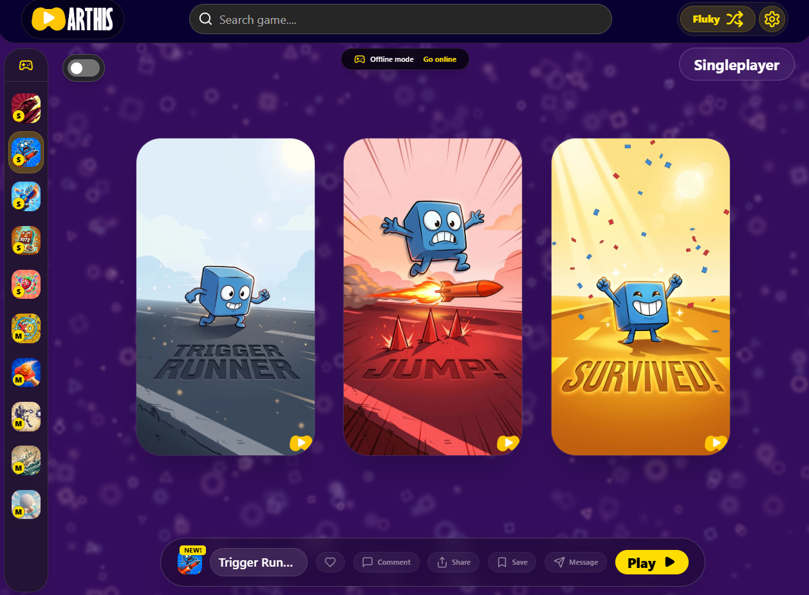
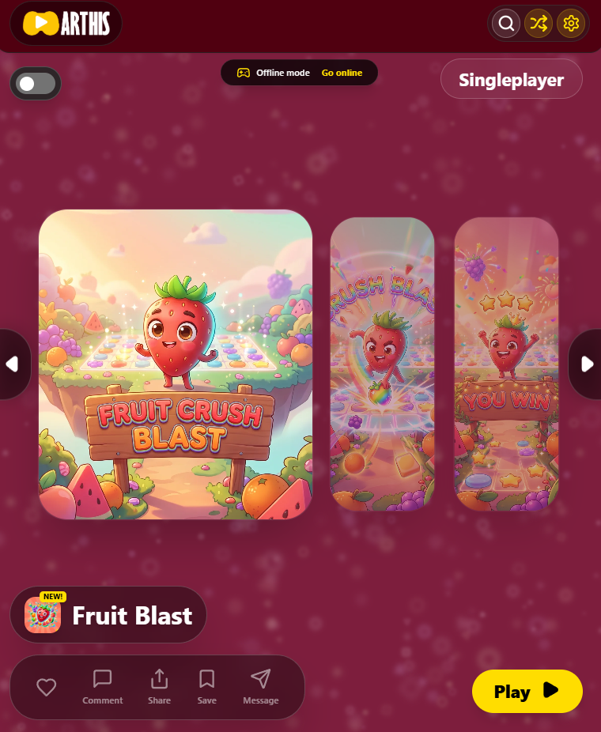
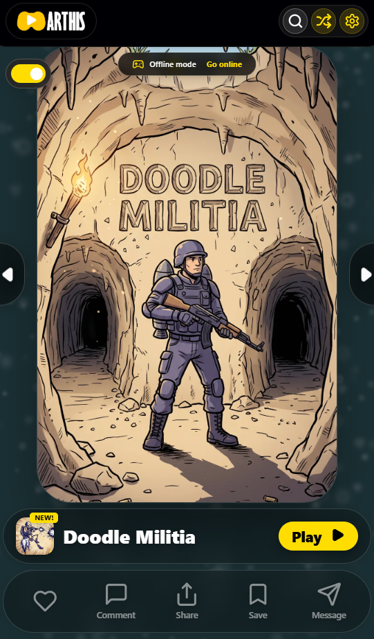

<div align="center">

# 🎮 ARTHIS.space — Mini Games

### An endless, swipeable feed of mini-games. Single-player and multiplayer. No installs.

[](https://arthis.space)
&nbsp;


</div>

<p align="center">
  
</p>

> _This repository is a project showcase. The source code for ARTHIS.space is private — this page explains what it is and how it works._

---

## What is ARTHIS.space?

**ARTHIS.space** is a browser-based mini-games platform with a **TikTok-style vertical feed**. You open the site and start playing immediately — swipe up for the next game, swipe down to go back. Every card in the feed is a complete, self-contained mini-game you can play in seconds, solo or with friends.

It's the front door to the wider **ARTHIS** universe.

## Highlights

- 📱 **Feed-first** — an infinite, swipeable stream of games, one per screen
- ⚡ **Zero friction** — games run instantly in the browser; nothing to download or install
- 🕹️ **Single-player & multiplayer** — quick solo rounds or real-time matches with others
- 🎨 **Handcrafted variety** — each game has its own look, rules, and feel
- 🌐 **Plays everywhere** — mobile-first, but works on any modern browser

## How it works

```text
                ┌──────────────────────────────┐
                │        ARTHIS.space feed      │
                │  (vertical, swipe-to-next UI) │
                └───────────────┬──────────────┘
                                │ loads on demand
              ┌─────────────────┼─────────────────┐
              ▼                 ▼                 ▼
      ┌─────────────┐   ┌─────────────┐   ┌─────────────┐
      │  Mini-game  │   │  Mini-game  │   │  Mini-game  │   …
      │  (solo)     │   │ (multiplayer)│  │  (solo)     │
      └─────────────┘   └──────┬──────┘   └─────────────┘
                               │ real-time rooms
                               ▼
                     ┌────────────────────┐
                     │  Match / sync layer │
                     │  (host + join code) │
                     └────────────────────┘
```

**The feed.** The home screen is a vertical, full-screen feed. Each game is a card; swiping loads the next game on demand, so the experience stays fast and light no matter how many games are in the catalog.

**Single-player games.** Self-contained HTML5 games that boot instantly in the browser — score, restart, and swipe on to the next.

**Multiplayer games.** Players join a shared room (host creates a room, others join), and the game state is kept in sync in **real time** so everyone sees the same thing at once. Rounds are short and pick-up-and-play.

## Tech

Built as a mobile-first web app.


## Screenshots

<table>
  <tr>
    <td width="50%" valign="top"></td>
    <td width="50%" valign="top"></td>
  </tr>
  <tr>
    <td align="center"><em>Fruit Blast — a match-style round</em></td>
    <td align="center"><em>Doodle Militia — swipe to the next game</em></td>
  </tr>
</table>

## The ARTHIS universe

| Project | What it is |
| ------- | ---------- |
| 🎮 **[ARTHIS.space](https://arthis.space)** | This — the mini-games feed |
| 🌆 **[ARTHIS.land](https://arthis.land)** | "The Wall," a Unity vertical-city experience |
| 🛰️ **[arthisland-relay](https://github.com/akversebusiness-beep/arthisland-relay)** | The real-time multiplayer relay backend |

---

<div align="center">
Made by <a href="https://github.com/akversebusiness-beep">@akversebusiness-beep</a> · <a href="https://arthis.space">arthis.space</a>
</div>
